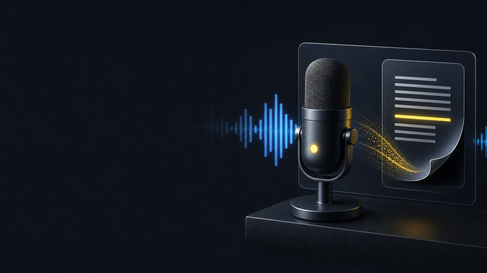

# VoiceToText

VoiceToText is a local Windows dictation app built in C++. It records from your
microphone, transcribes speech with whisper.cpp, optionally cleans the result
through an optional local LLM, and inserts the final text into the app you are
already using.

The app is built for fast everyday dictation: start it once, leave it in the
system tray, press a hotkey, speak, and get text back in the focused window.

## Highlights

- Swedish-first KB-Whisper model support.
- Internal Gemma model mode for cleanup/profile rewriting.
- Optional CUDA acceleration with automatic CPU/GPU selection.
- Microphone capture with voice activity detection and silence trimming.
- Optional local LLM cleanup and profile-based rewriting.
- Transcript history with raw, cleaned, and AI Language views.
- System tray controls and a floating status overlay.

## Quick Start

Clone the repository:

```powershell
git clone https://github.com/jojomondag/VoiceToTextApp.git
cd VoiceToTextApp
```

Download the default KB-Whisper model:

```powershell
.\scripts\download_model.ps1
```

Continue with [Setup And Configuration](docs/SETUP_AND_CONFIGURATION.md) for
build, run, packaging, and configuration details.

## Installers and Releases

Tagged GitHub releases build a Windows installer automatically. Download
`VoiceToText-Windows-Setup.exe` from the repository's Releases page and run it;
the app installs per-user and downloads its speech model on first use.

The repository also contains the macOS DMG packaging path in
`packaging/macos/build-dmg.sh`. The application itself currently depends on
Win32 APIs and therefore needs a macOS platform port before a functional macOS
installer can be published.



## Usage

Default hotkeys:

| Shortcut | Action |
| --- | --- |
| `Ctrl+Shift+Space` | Start or stop recording |
| `Escape` | Cancel the current recording while recording |
| `Ctrl+Shift+L` | Cycle language: Swedish, English, Auto |

Typical flow:

1. Put the cursor in any app where you want text.
2. Press `Ctrl+Shift+Space`.
3. Speak naturally.
4. Press `Ctrl+Shift+Space` again.
5. The final text appears in the focused app.

You can also use the tray menu to start recording, switch language, change the
KB Whisper model, choose a Gemma cleanup model, change compute mode, open
History, or exit.

## History And Profiles

The History window keeps recent dictations and shows:

- Recorded voice: raw Whisper output.
- Clean transcript: text after cleanup/profile transformation.
- AI Language: compact AI-readable version for prompt-heavy workflows.

Each history row includes copy buttons and profile controls. Clicking the
profile text or profile icon switches the History window into the profile
editor. From there you can edit how each profile transforms cleaned text,
create new profiles, rename profiles, and go back to history.

History is stored in `transcript_history.json` next to the executable unless
configured otherwise.

## Setup And Configuration

See [Setup And Configuration](docs/SETUP_AND_CONFIGURATION.md) for requirements,
model downloads, build commands, packaging, configuration settings, and local
LLM setup.

## Repository Notes

Generated build folders such as `build` and `build-cuda` are local build
artifacts. They are not required to understand or modify the source code.

## License

MIT License. See [LICENSE](LICENSE).
